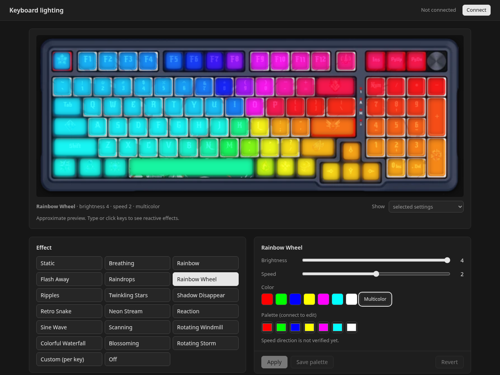
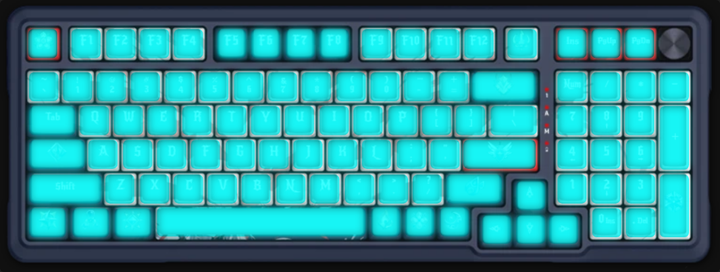
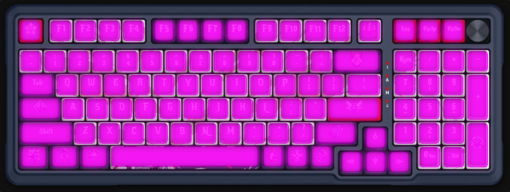
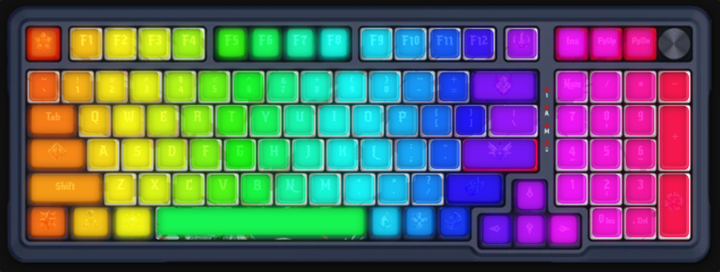
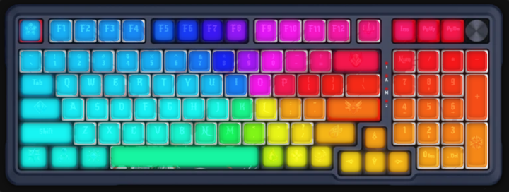
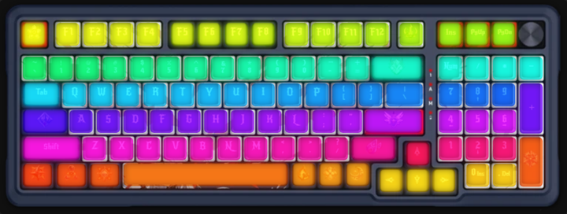
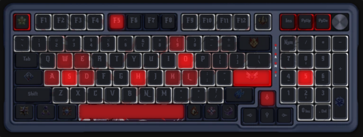
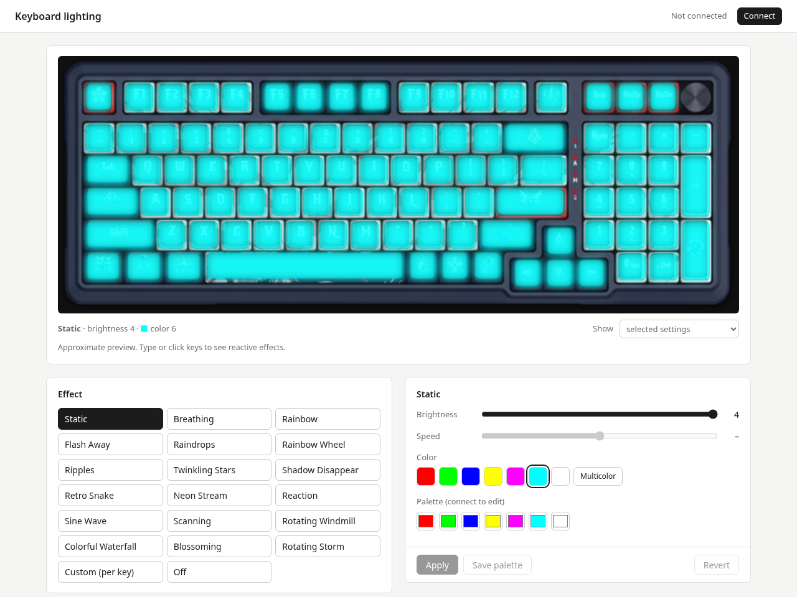

# k686-linux

Configure the lighting of the **Redragon K686 RGB PRO (Eisa)** keyboard on Linux, no Windows software needed.
It is a single HTML page that talks to the keyboard's 2.4 GHz receiver through **WebHID** in Chromium-based browsers.



## Features

| Feature | Status |
|---|---|
| 20 hardware lighting effects (Static, Breathing, Rainbow, Reaction, …) | ✅ read & write |
| Brightness (0–4), speed (0–4), color from palette or multicolor | ✅ read & write |
| Palette editor (7 colors per effect) | ✅ read & write |
| Live, animated preview on a picture of the keyboard | ✅ |
| Battery level and link status of the receiver | ✅ |
| Key map, per-key colors, macros | 👀 read-only (raw) |
| Key remapping, macro editing, per-key color editing | ❌ not yet |
| Wired mode (USB `258a:010c`) | ❌ not yet, different protocol |
| Firmware update | ❌ never, use the vendor tool on Windows |

The page never sends firmware, reset, remap or macro commands. Every write first reads the current
state from the keyboard, shows which bytes will change, asks for confirmation and reads the result back
to verify it.

### Preview

Effects are simulated in the browser, so the animation is an approximation of what the keyboard does.
Reactive effects respond to what you type or click.

| | | |
|---|---|---|
|  |  |  |
| Static | Breathing | Rainbow |
|  |  |  |
| Rainbow Wheel | Colorful Waterfall | Reaction |

Light theme follows the system setting:



## Supported hardware

| Device | USB ID | Status |
|---|---|---|
| K686 RGB PRO 2.4 GHz receiver ("CX 2.4G Wireless Receiver") | `3554:fa09` | ✅ tested |
| K686 RGB PRO wired | `258a:010c` | ❌ not supported yet |

Check what you have with `lsusb | grep -iE '3554|258a'`.

## Quick start

You need three things: a udev rule (so your user may open `/dev/hidraw*`), a Chromium-based browser
and any local web server (WebHID only works on `https://` or `http://localhost`).

```sh
git clone https://github.com/kacperkwasek/k686-linux.git
cd k686-linux

# 1. allow your user to access the receiver (once)
sudo cp 60-redragon-k686.rules /etc/udev/rules.d/
sudo udevadm control --reload-rules
sudo udevadm trigger --subsystem-match=hidraw
# or simply unplug and replug the receiver

# 2. serve the page locally
python3 -m http.server 8000 --bind 127.0.0.1

# 3. open http://localhost:8000 in Chromium / Chrome / Brave / Edge and click "Connect"
```

In the browser's device chooser pick **"2.4G Wireless Receiver"**. The page then reads the link state,
battery, lighting and palettes from the keyboard.

> Firefox and Safari do not implement WebHID, so they cannot be used.

## Distribution-specific setup

The udev rule uses `TAG+="uaccess"`, which grants access to the user logged in at the local seat.
This works on every distribution with **systemd-logind** or **elogind**. For systems without either,
see [Without systemd-logind](#without-systemd-logind--elogind).

### Fedora

```sh
sudo dnf install chromium python3
sudo cp 60-redragon-k686.rules /etc/udev/rules.d/
sudo udevadm control --reload-rules && sudo udevadm trigger --subsystem-match=hidraw
python3 -m http.server 8000 --bind 127.0.0.1
chromium-browser http://localhost:8000
```

### Debian / Ubuntu / Linux Mint / Pop!_OS

On Debian and Mint `chromium` is a regular package:

```sh
sudo apt install chromium python3
sudo cp 60-redragon-k686.rules /etc/udev/rules.d/
sudo udevadm control --reload-rules && sudo udevadm trigger --subsystem-match=hidraw
python3 -m http.server 8000 --bind 127.0.0.1
chromium http://localhost:8000
```

On **Ubuntu** `chromium` is a Snap, which cannot see HID devices by default. Either connect the
`raw-usb` interface:

```sh
sudo snap install chromium
sudo snap connect chromium:raw-usb
```

or install Google Chrome from its `.deb` package instead.

### Arch Linux / Manjaro / EndeavourOS

```sh
sudo pacman -S chromium python
sudo cp 60-redragon-k686.rules /etc/udev/rules.d/
sudo udevadm control --reload-rules && sudo udevadm trigger --subsystem-match=hidraw
python -m http.server 8000 --bind 127.0.0.1
chromium http://localhost:8000
```

### openSUSE Tumbleweed / Leap

```sh
sudo zypper install chromium python3
sudo cp 60-redragon-k686.rules /etc/udev/rules.d/
sudo udevadm control --reload-rules && sudo udevadm trigger --subsystem-match=hidraw
python3 -m http.server 8000 --bind 127.0.0.1
chromium http://localhost:8000
```

### NixOS

`/etc/udev/rules.d` is read-only on NixOS, so add the rule to `configuration.nix` and rebuild:

```nix
services.udev.extraRules = ''
  SUBSYSTEM=="hidraw", ATTRS{idVendor}=="3554", ATTRS{idProduct}=="fa09", TAG+="uaccess"
  SUBSYSTEM=="hidraw", ATTRS{idVendor}=="258a", ATTRS{idProduct}=="010c", TAG+="uaccess"
'';
```

```sh
sudo nixos-rebuild switch
nix-shell -p chromium python3 --run 'python3 -m http.server 8000 --bind 127.0.0.1 & chromium http://localhost:8000'
```

### Flatpak browsers (any distribution)

Flatpak sandboxes do not expose `/dev/hidraw*` unless allowed:

```sh
flatpak override --user --device=all org.chromium.Chromium   # or com.google.Chrome, com.brave.Browser
```

The udev rule is still required on the host.

### Without systemd-logind / elogind

`uaccess` has no effect without a seat manager (for example minimal Alpine, Void or Gentoo setups).
Use a group instead. Replace `TAG+="uaccess"` in the rule file with a group, create the group and add
yourself to it:

```sh
sudo groupadd -f hidraw
sudo usermod -aG hidraw "$USER"
sudo sed -i 's/TAG+="uaccess"/MODE="0660", GROUP="hidraw"/' /etc/udev/rules.d/60-redragon-k686.rules
sudo udevadm control --reload-rules && sudo udevadm trigger --subsystem-match=hidraw
# log out and back in so the new group applies
```

## Checking the setup

```sh
# which hidraw nodes belong to the receiver
grep -l 3554 /sys/class/hidraw/*/device/uevent

# your user should appear in the ACL (uaccess) or the group should be hidraw
getfacl /dev/hidraw4      # use the node number found above
```

The receiver has two HID interfaces. The configuration channel is **interface 1**, vendor collection
`UsagePage 0xFF02 / Usage 0x02`, report ID `0x13`. The page picks it automatically. Under
**Advanced → HID interfaces** you can see all interfaces and collections the browser exposes.

## Troubleshooting

| Problem | Fix |
|---|---|
| The device chooser is empty | udev rule not active (replug the receiver), Snap/Flatpak permissions, or a browser without WebHID. |
| `Failed to open the device` | Another program has the device open, or the ACL is missing; see [Checking the setup](#checking-the-setup). |
| First read after a pause times out | The keyboard puts its radio to sleep; the page waits up to 4 s and retries. Press any key to wake it. |
| "Keyboard asleep or out of range" | The receiver is connected, but the keyboard is off or asleep. Switch it on / press a key, then **Reload**. |
| Changing a palette has no visible effect | Some effects have an empty palette stored on the keyboard, or do not use one (Rainbow, Windmill, Waterfall, Blossoming). |

## How it works

The protocol was reconstructed from the vendor's Windows tool (static analysis) and verified on the
device. In short:

* Output/Input report `0x13`, 19 data bytes:
  `cmd · total packets · packet index · (sub << 4 | length) · 14 data bytes · checksum`.
* Checksum = sum of all bytes **including the report ID** `0x13`, modulo 256.
* Reads: one request frame, the keyboard answers with as many packets as needed.
* Writes: data is split into 14-byte packets; each packet is acknowledged by an echo of the frame.
* Lighting is a 128-byte block (`0x44` read / `0x04` write): byte `0x0A` selects the effect, and every
  effect has its own brightness and speed/color byte pair at `0x3A + 2·i`.
* Palettes (`0x49` / `0x09`): 21 bytes (7 × RGB) per effect.

Full notes, including command list, offsets and what is still unverified, are in
[PROTOKOL.md](PROTOKOL.md) (Polish).

## Disclaimer

This is an unofficial project, not affiliated with or endorsed by Redragon. Use it at your own risk.
Only lighting commands that were verified on the device are writable; everything else is read-only.
The keyboard picture used for the preview comes from the vendor's configuration software.
